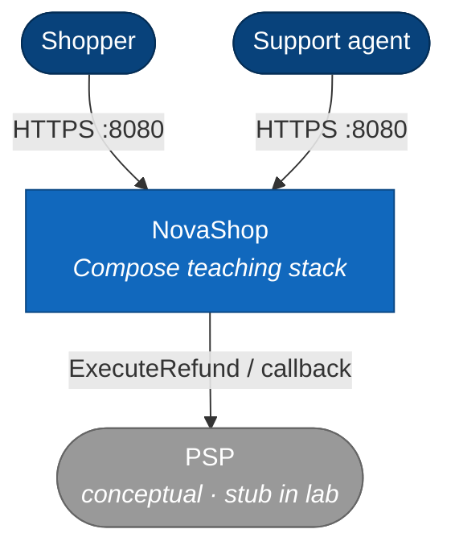

# Level 1 · System Context

NovaShop：教学用迷你电商标本（Ontology 动能概念的分布式近似 + DDD 限界上下文）。

阅读方向：**上 → 下**（人 → 系统 → 外部副作用）。

## 读图

| 元素 | 含义 |
|------|------|
| Shopper / Agent | 都经 `demo-web` |
| NovaShop | 本仓全部可部署服务 + Postgres + RabbitMQ |
| PSP | 概念外部；实现为 `StubPspRefundClient` |

## 非目标

真实 Foundry / OSDK · 完整 IAM · 独立 Payment 捕获 BC  

下一层 → [02-container.md](./02-container.md)
