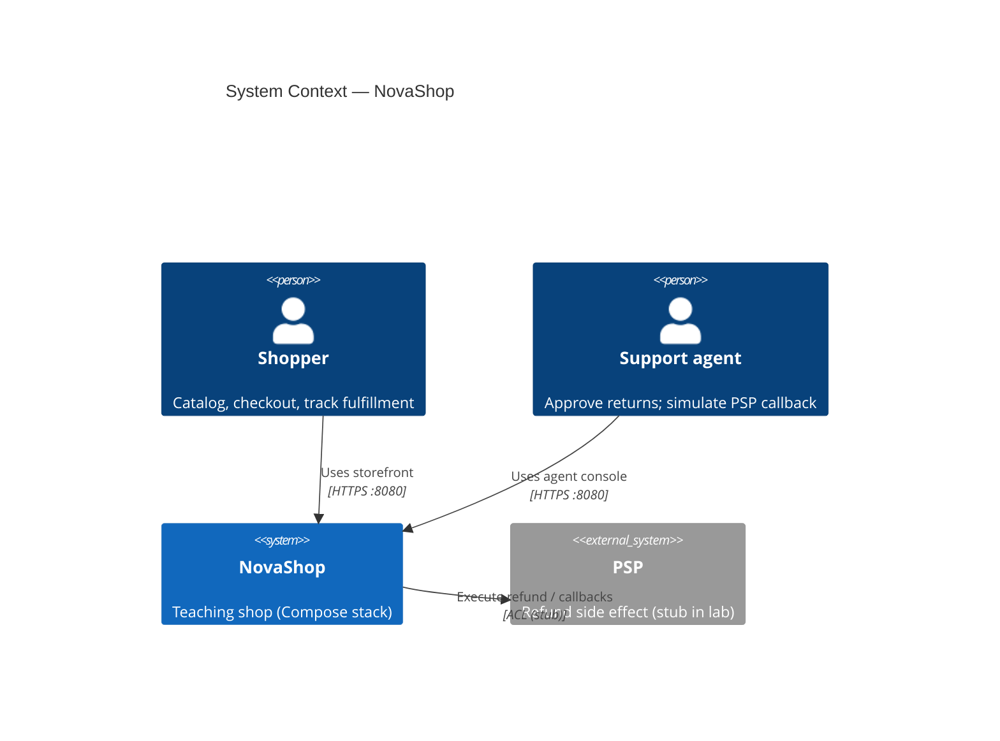

# C4 Level 1 · System Context

NovaShop 是**教学用**迷你电商标本：在权威微服务内模拟 Foundry Ontology 动能，并用 DDD 限界上下文拆分售后与履约。

## 读图要点

| 元素 | 含义 |
|------|------|
| Shopper / Agent | 都走 `demo-web`（:8080） |
| NovaShop | 本仓全部可部署服务 + Postgres + RabbitMQ |
| PSP | 概念外部；课内为 Stub → Container 图 |

## 非目标

- 真实 Foundry Ontology / OSDK  
- 完整 IAM（仅 `X-Actor-*` 头）  
- 独立 Payment 捕获 BC（`paymentId` 由 commerce mint）

下一层 → [02-container.md](./02-container.md)
