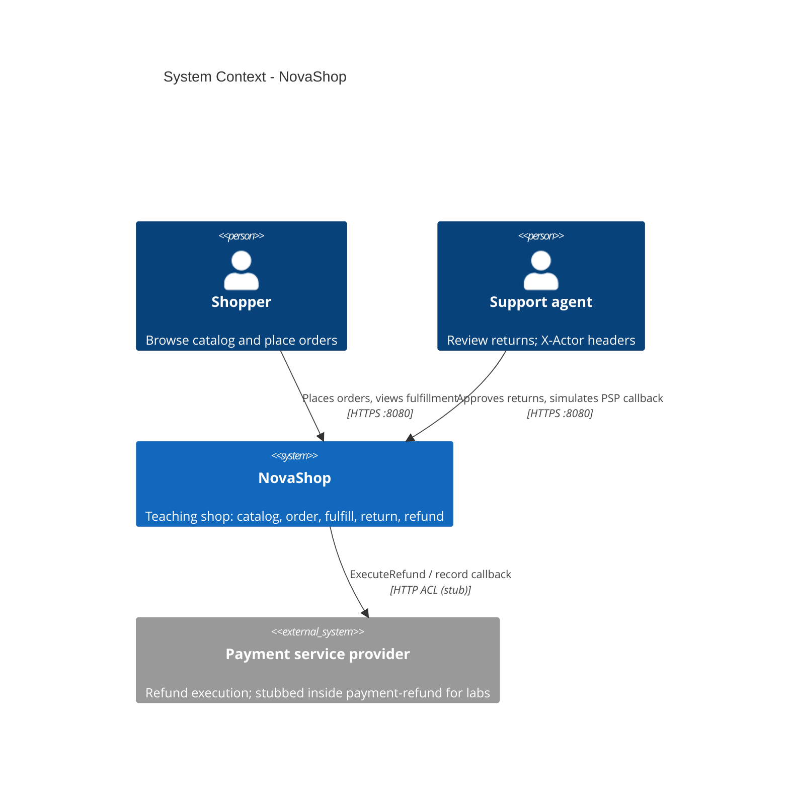

# C4 Level 1 · System Context

NovaShop 是一套**教学用**迷你电商标本：在权威微服务内模拟 Foundry Ontology 的动能概念，并用 DDD 限界上下文拆分售后与履约。

## 读图要点

| 元素 | 含义 |
|------|------|
| Shopper | 经 `demo-web` 看目录、下单、看履约 |
| Support agent | 经同一 UI 申请/审批退货；演示「Simulate PSP callback」 |
| NovaShop | 本仓库全部可部署服务 + Postgres + RabbitMQ |
| PSP（外部） | 概念上的支付侧效应；**课内实现为 Stub**，见 Container 图 |

## 非目标（Context 外）

- 真实 Foundry Ontology / OSDK
- 完整 IAM（仅 `X-Actor-Id` / `X-Actor-Role` 头）
- 独立 Payment 捕获 BC（`paymentId` 由 commerce mint）

下一层 → [02-container.md](./02-container.md)
