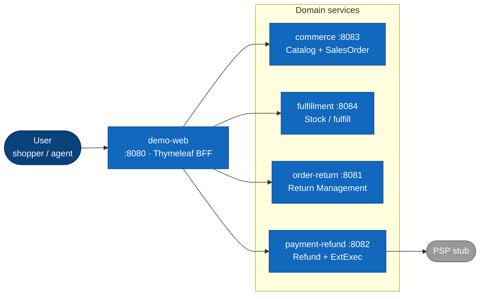

# Level 2 · Containers

每个框 = 可部署进程（或基础设施）。  
**一张图只保留一个主方向的线**；持久化不画四条 JDBC，改用表。

`platform/` = 事件 DTO 共享模块，不是容器。

---

## 2.1 HTTP 同步面

人 → BFF → 各 BC。线全部 **左 → 右**，服务竖排，避免交叉。

退货**创建**：demo-web 读订单 JSON → `POST /returns` 种子（非正式 ACL）→ [handbook/02 §4](../handbook/02-ontology-to-ddd-map.md)。

---

## 2.2 异步事件面

两条**独立直线**路径（不共用一张蜘蛛网）。

### 下单 → 履约

### 售后闭环

（图上 RabbitMQ 画两次，表示同一总线的两次投递，避免双向箭头交叉。）

---

## 持久化（不画线）

| 服务 | 库（Postgres 同实例） |
|------|------------------------|
| commerce | `commerce` |
| fulfillment | `fulfillment` |
| order-return | `order_return` |
| payment-refund | `payment_refund` |

宿主机端口推荐 `POSTGRES_HOST_PORT=5433`。

## 容器对照

| Container | 端口 | 职责 |
|-----------|------|------|
| demo-web | 8080 | 演示 BFF |
| commerce | 8083 | Catalog + SalesOrder |
| fulfillment | 8084 | Inventory / Fulfillment |
| order-return | 8081 | Return Management |
| payment-refund | 8082 | Refund（捕获 deferred） |

下一层 → [03-component-return-refund.md](./03-component-return-refund.md)
