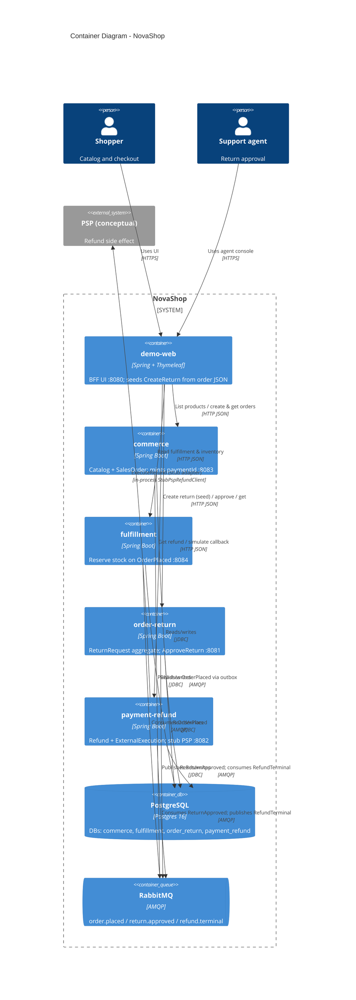

# C4 Level 2 · Containers

每个 **Container** = 可独立部署的进程（或托管基础设施）。`platform/` 只是事件 DTO 的共享模块，不画成容器。

## 容器 ↔ 限界上下文

| Container | 端口 | BC / 职责 |
|-----------|------|-----------|
| `demo-web` | 8080 | 演示 BFF（非领域权威） |
| `commerce` | 8083 | Catalog + SalesOrder |
| `fulfillment` | 8084 | Inventory / Fulfillment |
| `order-return` | 8081 | Return Management |
| `payment-refund` | 8082 | Payment / Refund（捕获仍 deferred） |
| PostgreSQL | 5433→5432 | 每服务一库 |
| RabbitMQ | 5672 / 15672 | 集成事件总线 |

## 两条集成路径（对照手册）

1. **下单 → 履约**：`commerce` outbox `OrderPlaced` → `fulfillment` 预留库存  
2. **售后闭环**：审批 outbox `ReturnApproved` → `payment-refund` 建 `Refund(PENDING_…)` → Stub/回调 → `RefundTerminal` → 退货侧投影  

退货**创建**不经 Rabbit：demo-web 读订单 JSON 后 `POST /returns` 种子字段（教学过渡，非正式跨 BC ACL）→ [handbook/02 §4](../handbook/02-ontology-to-ddd-map.md)。

## 事件名（契约在 `platform/`）

| 路由键 / 逻辑名 | 发布方 | 消费方 |
|-----------------|--------|--------|
| `OrderPlaced` | commerce | fulfillment |
| `ReturnApproved` | order-return | payment-refund |
| `RefundTerminal` | payment-refund | order-return |

下一层 → [03-component-return-refund.md](./03-component-return-refund.md)
