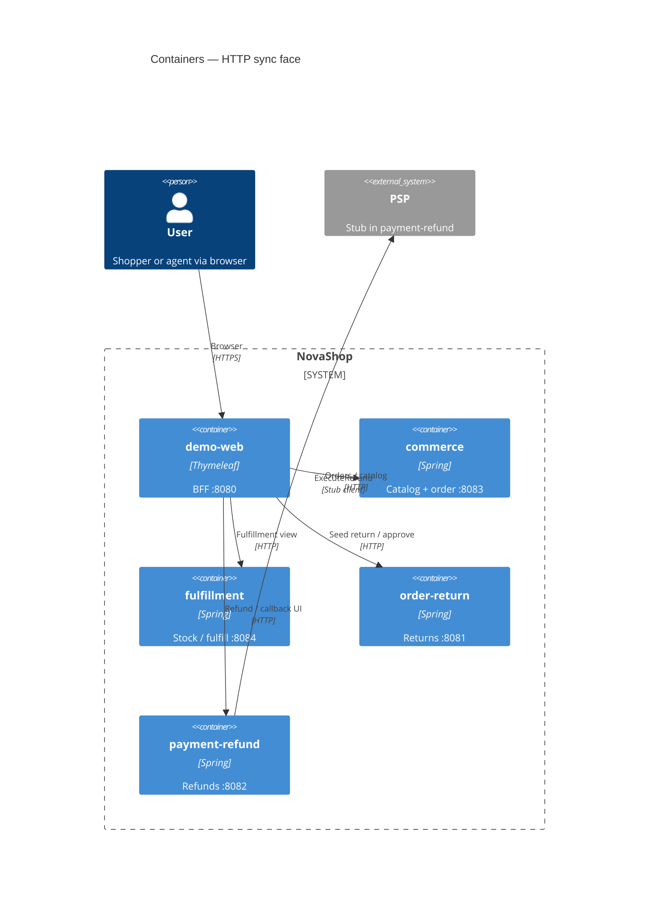
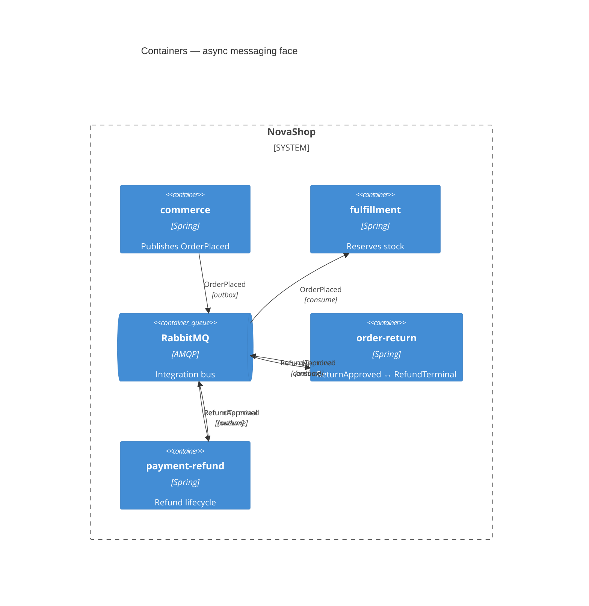

# C4 Level 2 · Containers

每个 **Container** = 可独立部署的进程（或托管基础设施）。  
为避免「所有线画在一张图上」，拆成 **HTTP 同步面** 与 **异步事件面**；持久化用表说明，不再画四条 JDBC 蜘蛛网。

---

## 2.1 HTTP 同步面（人 → BFF → 服务）

要点：退货**创建**是 demo-web 读订单 JSON 后种子 `POST /returns`（非正式 ACL）→ [handbook/02 §4](../handbook/02-ontology-to-ddd-map.md)。

---

## 2.2 异步事件面（Outbox → Rabbit → 消费）

---

## 容器 ↔ 限界上下文

| Container | 端口 | BC / 职责 |
|-----------|------|-----------|
| `demo-web` | 8080 | 演示 BFF（非领域权威） |
| `commerce` | 8083 | Catalog + SalesOrder |
| `fulfillment` | 8084 | Inventory / Fulfillment |
| `order-return` | 8081 | Return Management |
| `payment-refund` | 8082 | Payment / Refund（捕获仍 deferred） |
| PostgreSQL | 5433→5432 | **每服务一库**（JDBC；图上省略四条线） |
| RabbitMQ | 5672 / 15672 | 见上图 |

`platform/` = 事件 DTO 共享模块，非容器。

## 事件契约

| 事件 | 发布 | 消费 |
|------|------|------|
| `OrderPlaced` | commerce | fulfillment |
| `ReturnApproved` | order-return | payment-refund |
| `RefundTerminal` | payment-refund | order-return |

下一层 → [03-component-return-refund.md](./03-component-return-refund.md)
