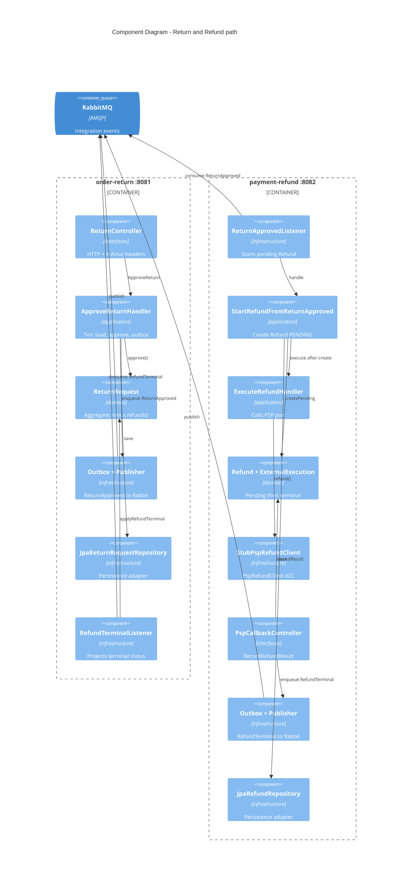

# C4 Level 3 · Component（售后切片）

只展开 **order-return** 与 **payment-refund** 的内部组件，对应 Evans 实用四层 + 端口倒置。其它服务同构，不重复画。

类级走读 → [handbook/03-layered-code-tour.md](../handbook/03-layered-code-tour.md)。



## 依赖方向（每个服务内）

```text
interfaces / infrastructure  →  application  →  domain
```

- **domain**：无 Spring / JPA  
- **application**：用例编排；只依赖端口  
- **infrastructure**：JPA、Rabbit、Stub PSP  
- **interfaces**：HTTP 适配

## 与 Ontology 概念的对应

| Ontology（模拟） | 组件落点 |
|------------------|----------|
| Action `ApproveReturn` | `ApproveReturnHandler` + `ReturnRequest.approve` |
| edit-set 跨对象 | 拆成本地事务 + `ReturnApproved` 消息（非单库原子） |
| ExternalExecution | `ExternalExecution` 实体 + `StubPspRefundClient` |
| 预分配 `refundId` | `ReturnRequest.approve` 铸 ID → outbox → 同 ID 建 `Refund` |

时序化协作 → [04-dynamic-approve-refund.md](./04-dynamic-approve-refund.md)
