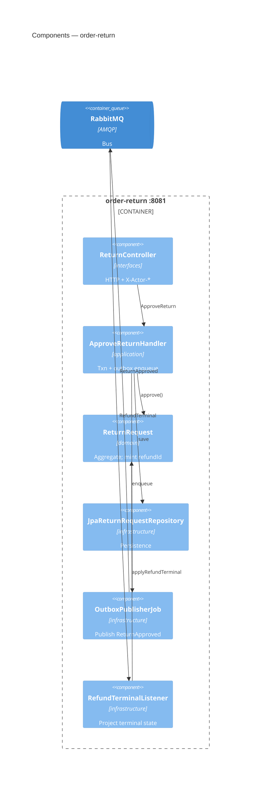
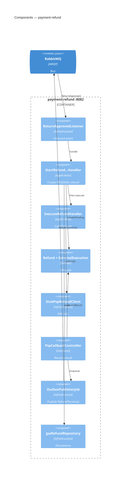

# C4 Level 3 · Component（售后切片）

两个服务**分图竖向排列**（interfaces → application → domain ← infrastructure），避免左右对打交叉线。  
类级走读 → [handbook/03-layered-code-tour.md](../handbook/03-layered-code-tour.md)。

---

## 3.1 order-return



---

## 3.2 payment-refund



---

## 依赖方向（每个服务内）

```text
interfaces / infrastructure  →  application  →  domain
```

| Ontology（模拟） | 落点 |
|------------------|------|
| Action `ApproveReturn` | `ApproveReturnHandler` + `ReturnRequest.approve` |
| 跨对象 edit-set | 本地事务 + `ReturnApproved`（非单库原子） |
| ExternalExecution | 领域实体 + `StubPspRefundClient` |
| 预分配 `refundId` | 审批铸 ID → 同 ID 建 `Refund` |

时序 → [04-dynamic-approve-refund.md](./04-dynamic-approve-refund.md)
