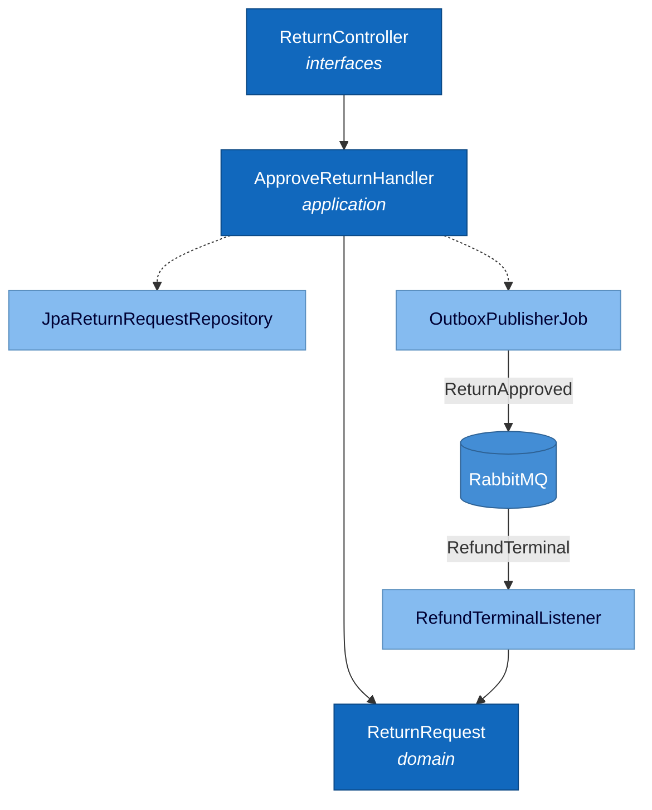
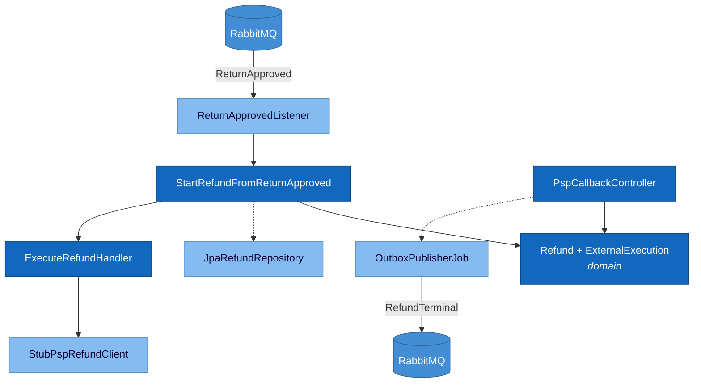

# Level 3 · Component（售后切片）

只展开售后两服务。阅读方向：**上 → 下**（接口 → 应用 → 领域；基础设施挂在侧枝）。  
类级走读 → [handbook/03](../handbook/03-layered-code-tour.md)。

---

## 3.1 order-return



主链实线（用例）；虚线 = 端口适配（持久化 / 出站）。

---

## 3.2 payment-refund



入站事件在上，回调与出站在下；仍是单向下流，无左右对打。

---

## 依赖方向

```text
interfaces / infrastructure  →  application  →  domain
```

| Ontology（模拟） | 落点 |
|------------------|------|
| `ApproveReturn` | Handler + `ReturnRequest.approve` |
| edit-set | 本地 TX + `ReturnApproved` |
| ExternalExecution | 领域实体 + Stub PSP |
| 预分配 `refundId` | 审批铸 ID → 同 ID 建 Refund |

时序 → [04-dynamic-approve-refund.md](./04-dynamic-approve-refund.md)
