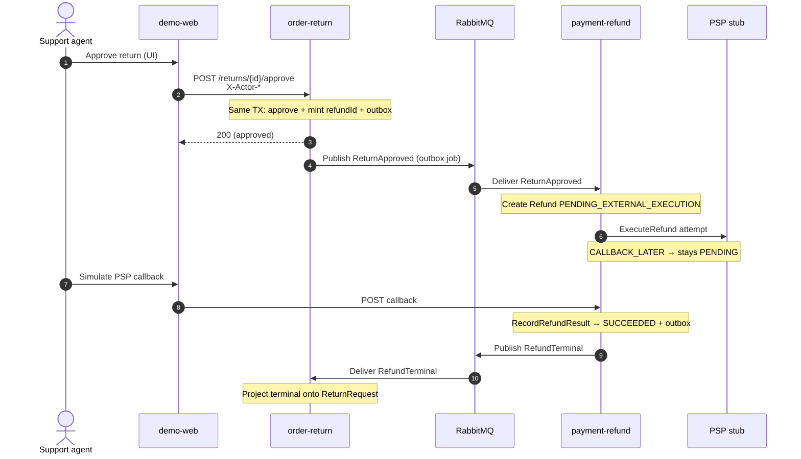

# Dynamic · 审批到退款终态

Phase 1 主线。此处用 **sequenceDiagram**（C4 Dynamic 视图的常用画法）：编号步骤、少交叉，比 `C4Dynamic` 蜘蛛网更易读。

## 两处一致性边界

1. **审批本地事务**：`ReturnRequest` + outbox 同库提交  
2. **退款本地事务**：`Refund` / `ExternalExecution` + outbox  

跨服务无分布式事务：Ontology edit-set →「本地聚合 + 集成事件」。  
→ [handbook/02](../handbook/02-ontology-to-ddd-map.md) · [handbook/06](../handbook/06-retro-case-report.md)

## 中间态

`PSP_MODE=CALLBACK_LATER`（Compose 默认）：步骤 6–7 之间可断言 `PENDING_EXTERNAL_EXECUTION`。

## 代码锚点

| 步 | 锚点 |
|----|------|
| 审批 | `ApproveReturnHandler`、`ReturnRequest.approve` |
| 出站 | order-return `OutboxPublisherJob` |
| 入站退款 | `ReturnApprovedListener`、`StartRefund…`、`ExecuteRefundHandler` |
| 回调 | `PspCallbackController`、`RecordRefundResultHandler` |
| 投影 | `RefundTerminalListener` |
