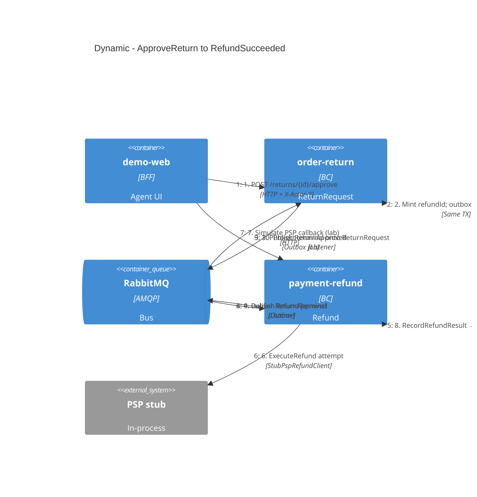

# C4 Dynamic · 审批到退款终态

一张图看清 Phase 1 核心路径（smoke / 实验单主线）。编号即调用顺序。

## 两处一致性边界（复盘核心）

1. **审批本地事务**：`ReturnRequest` 状态 + outbox 行同库提交；消息稍后发出  
2. **退款本地事务**：`Refund` / `ExternalExecution` 与 outbox；PSP 调用在事务策略下受控（见用例与 Stub 模式）

跨服务**没有**分布式事务：Ontology 单 Action edit-set 被翻译成「本地聚合 + 集成事件」。详解 → [handbook/02](../handbook/02-ontology-to-ddd-map.md)、[handbook/06](../handbook/06-retro-case-report.md)。

## 中间态为何可见

Compose 默认 `PSP_MODE=CALLBACK_LATER`：步骤 6 不立刻成功，步骤 7 由 demo-web「Simulate PSP callback」或 smoke 脚本触发，便于断言 `PENDING_EXTERNAL_EXECUTION`。

## 相关代码锚点

| 步骤 | 锚点 |
|------|------|
| 1–2 | `order-return/.../ApproveReturnHandler.java`、`ReturnRequest.approve` |
| 3 | `OutboxPublisherJob`（order-return） |
| 4–6 | `ReturnApprovedListener`、`StartRefundFromReturnApprovedHandler`、`ExecuteRefundHandler` |
| 7–8 | `PspCallbackController`、`RecordRefundResultHandler` |
| 9–10 | payment outbox → `RefundTerminalListener`（order-return） |
