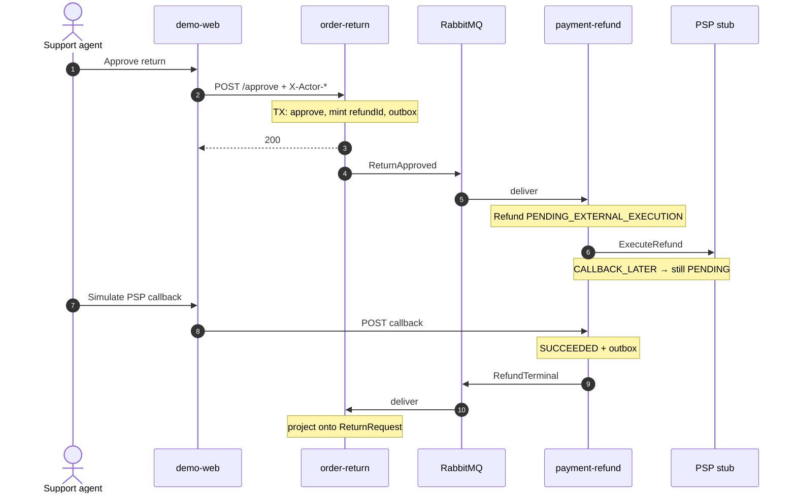

# Dynamic · 审批到退款终态

用 `sequenceDiagram`（C4 Dynamic 视图的推荐画法）：参与者从左到右固定，步骤自上而下编号。

## 两处一致性边界

1. 审批：`ReturnRequest` + outbox 同库  
2. 退款：`Refund` / `ExternalExecution` + outbox  

无跨服务分布式事务 → [handbook/02](../handbook/02-ontology-to-ddd-map.md) · [06](../handbook/06-retro-case-report.md)

## 锚点

| 步 | 代码 |
|----|------|
| 审批 | `ApproveReturnHandler`、`ReturnRequest.approve` |
| 出站 | order-return `OutboxPublisherJob` |
| 入站退款 | `ReturnApprovedListener` → `StartRefund…` → `ExecuteRefundHandler` |
| 回调 | `PspCallbackController`、`RecordRefundResultHandler` |
| 投影 | `RefundTerminalListener` |
