# DDD 应用架构：分层、六边形、洋葱、整洁与清晰

这份材料按同一条业务规则，分别说明五种应用架构的概念、作者原图和示例代码。它们组织的是**一个应用内部**代码如何依赖，不是微服务如何拆分，也不是 DDD 的战略设计本身。

统一的业务规则是：客户下单时，订单金额不得超过该客户剩余信用额度；通过则保存订单。金额用「分」表示，避免示例被货币库打断。示例是 Java，只为看清依赖方向。事务、框架注解和完整工程结构都省略了。

五种架构的陈述只依据提出者自己的文本：Evans 2003、Cockburn 2005、Palermo 2008、Martin 2011 与 2012、Graça 2017 与 2018。Graça 系列里对前四种架构的转述，不作为那四种的出处。示例代码按这些原文里的依赖规则写成；除注明摘自原文的片段外，不是原作者的代码。作者公开发表的图嵌在下文，版权归原作者。Evans 的书中图不转载。

## 1. 谱系

| 年份 | 名称 | 作者 | 这一代写死的东西 |
| --- | --- | --- | --- |
| 1992 | 前史 | Ivar Jacobson | Martin 2012 把 BCE 列为来源，并指向 *Object-Oriented Software Engineering*。本文不转述该书用语 |
| 2003 | 分层架构 Layered Architecture | Eric Evans | 用户界面、应用、领域、基础设施四层；层只依赖其下 |
| 2005-09-04 | 六边形 / 端口与适配器 | Alistair Cockburn | 应用在内，技术在外；端口按对话目的划分；主适配器驱动应用，次适配器被应用驱动 |
| 2008-07-29 | 洋葱架构 Onion Architecture | Jeffrey Palermo | 耦合只指向中心；领域模型在正中心；仓储接口在应用核心，实现在核心外 |
| 2012-08-13 | 整洁架构 Clean Architecture | Robert C. Martin | 把六边形、洋葱、Screaming Architecture、DCI、BCE 收成一条依赖规则；用例单独成圈；跨边界传递简单数据结构 |
| 2017-11-16 | 清晰架构 Explicit Architecture | Herberto Graça | 端口、洋葱内层、用例、CQRS、应用事件、按组件分包画进同一张图 |

本文的「清晰架构」专指 Graça 的 Explicit Architecture。直译更接近「显式架构」，两种译名都有人用。有些中文材料把 Martin 的 Clean Architecture 也译成「清晰架构」；阅读时以英文原名为准。

这五套不是逐一修补的产品线。Cockburn 2005 批评的是一般的分层画法，文章没有回应 Evans。Palermo 声明洋葱与六边形共享「外置基础设施」这一前提，他批评的是自己画出的传统三层，不是 Evans 的四层。Martin 把六边形、洋葱、DCI、BCE 等看成目标相同的做法，并试着收成一张图；2012 年的文章没有引用 Evans。只有 Graça 明确把前面各家合在一张图里。它们也不是五选一的互斥方案。

## 2. 分层架构（Evans，2003）

### 2.1 概念

Evans 在《领域驱动设计》第 4 章用分层把领域模型从界面和技术代码里隔出来，使模型驱动设计成为可能。四层职责可以按该章意译为：

- **用户界面（User Interface）**：向用户展示信息，解释用户命令。外部执行者有时是另一个计算机系统，不是人。
- **应用（Application）**：定义软件要完成的任务，指挥领域对象把任务做完。这一层薄，不包含业务规则，只协调任务并把工作委托给领域对象。它可以保存「这个任务进行到哪一步」的状态，不保存业务状态。
- **领域（Domain）**：表示业务概念、业务状况和业务规则。反映业务状况的状态在这里控制和使用；存储的技术细节交给基础设施。Evans 称这一层为业务软件的核心。
- **基础设施（Infrastructure）**：为上面各层提供通用技术能力，例如替应用发送消息、替领域做持久化、替界面绘制控件。它也可以用架构框架支持四层之间的交互。

层间关系同样来自第 4 章，这里是意译，不是长段摘录：

- 每一层内聚，并且只依赖它下面的层。
- 上层通过下层的公开接口调用下层。下层要向上传递信息时，用回调或观察者，不反过来依赖上层。
- 基础设施通常不主动发起领域层的动作。它在领域层下面，不应具备所服务领域的专门知识。
- 应用层和领域层调用基础设施提供的服务。并非所有基础设施都以这种可调用服务的形式存在。

因此，2003 年这张图的依赖是**向下**的。领域层在概念上是核心，在编译依赖上仍然可以使用它下面的基础设施。

第 6 章把 Repository 写成按集合提供领域对象的机制，重组已存储对象时会用到数据库或映射技术。第 4 章的分层表没有把这画成「基础设施依赖领域层」。后四种架构里「核心不依赖具体数据库」的句子，分别出自各作者自己的文本。Cockburn 写的是应用与适配器，参考文献是 Martin 的依赖倒置、Fowler 的依赖注入和 GoF 的 Adapter。Palermo 写的是耦合指向中心。Martin 写的是依赖规则。Graça 写的是端口留在应用核心里面。这些句子不从 Evans 的仓储章推出来。

### 2.2 架构图

书中原图见 Evans 2003 第 4 章 *Isolating the Domain*。Layered Architecture 一节（手稿约第 52 页起，成书约第 68 页起）把四层画成一张两列表，不是箭头图。左列是层名，右列是职责，顺序自上而下。下表沿用这个版式。右列是意译，不是书中整段文字；书中插图不转载。

| 层 | 职责 |
| --- | --- |
| User Interface（aka Presentation Layer） | 向用户展示信息，解释用户命令。外部执行者有时是另一个计算机系统。 |
| Application Layer | 定义软件要做的任务，指挥领域对象完成。这一层薄，不含业务规则，也不保存业务状态；可以保存任务进行到哪一步。 |
| Domain Layer（aka Model Layer） | 表示业务概念、业务状况和业务规则。业务状态在这里控制；存储的技术细节交给基础设施。这一层是业务软件的核心。 |
| Infrastructure Layer | 为上面各层提供通用技术能力：替应用发送消息，替领域做持久化，替界面绘制控件。也可以用架构框架支持四层之间的交互。 |

依赖方向写在正文里，没有画在这张表上：某一层只依赖本层和它下面的层，因此可以越过紧邻的一层去调用更下面的层。下层要向上传递信息时，用回调或观察者。Relating the Layers 在成书约第 72 页。

同章 Figure 4.2 是转账示例。手稿在这张图旁列出的分区名是 User Interface、Application、Domain、Infrastructure，对象包括 transferController、FundsTransfer Service、Account、Unit of Work Manager、O-R Mapper。图注说明领域层负责「有贷必有借，一边失败则整笔失败」，应用层不假设请求来自哪一种界面。手稿的文本抽取没有保留这张图的左右或上下版面，本文不补画。它是一次交互如何落进四层，不是另一套分层。

Palermo 在 2008 年画过他当时最常见的传统分层，用来对照洋葱架构。这张图是三块业务分层加上侧面的基础设施，**不是** Evans 的四层原图：

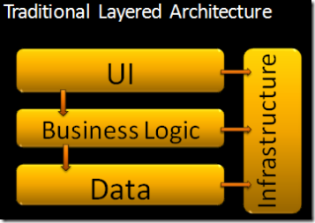

原图：Jeffrey Palermo, [The Onion Architecture : part 1](https://jeffreypalermo.com/2008/07/the-onion-architecture-part-1/)，2008-07-29。他的批评是：每一层依赖其下，传递依赖仍然是依赖，于是界面和业务逻辑都被绑在数据访问上。

### 2.3 示例代码

下面按第 4 章的依赖方向写：应用层调用基础设施里的存储对象。Evans 写明应用层和领域层都可以调用基础设施提供的服务。本示例把这次调用放在应用层，领域类里不写 SQL。这不表示书里禁止领域层调用基础设施服务。基础设施类在本示例里只接收字段，不引用领域类型，对应他写的「基础设施不应具备所服务领域的专门知识」。

#### 按第 4 章：依赖向下

```java
package layered.domain;

/** 领域对象。不引用界面，也不引用基础设施。 */
public final class Customer {
    private final String id;
    private final long creditLimitCents;
    private final long outstandingCents;

    public Customer(String id, long creditLimitCents, long outstandingCents) {
        this.id = id;
        this.creditLimitCents = creditLimitCents;
        this.outstandingCents = outstandingCents;
    }

    public String id() { return id; }

    public boolean canAfford(long orderCents) {
        return outstandingCents + orderCents <= creditLimitCents;
    }
}

public final class Order {
    private final String id;
    private final String customerId;
    private final long totalCents;

    public Order(String id, String customerId, long totalCents) {
        this.id = id;
        this.customerId = customerId;
        this.totalCents = totalCents;
    }

    public String id() { return id; }
    public String customerId() { return customerId; }
    public long totalCents() { return totalCents; }
}
```

```java
package layered.infrastructure;

/** 基础设施不了解领域类型，只保存应用层交来的字段。 */
public final class JdbcOrderStore {
    public void insert(String orderId, String customerId, long totalCents) {
        // SQL 留在这一层
    }
}

public final class JdbcCustomerStore {
    public CustomerRow find(String customerId) {
        return new CustomerRow(customerId, 10_000_00L, 2_000_00L);
    }

    public record CustomerRow(String id, long creditLimitCents, long outstandingCents) {}
}
```

```java
package layered.application;

import layered.domain.Customer;
import layered.domain.Order;
import layered.infrastructure.JdbcCustomerStore;
import layered.infrastructure.JdbcOrderStore;

/**
 * 应用层编排用例，业务判断留在 Customer。
 * 它依赖下方的基础设施具体类，这是第 4 章的依赖方向。
 */
public final class PlaceOrderService {
    private final JdbcCustomerStore customers;
    private final JdbcOrderStore orders;

    public PlaceOrderService(JdbcCustomerStore customers, JdbcOrderStore orders) {
        this.customers = customers;
        this.orders = orders;
    }

    public String place(String customerId, long amountCents) {
        var row = customers.find(customerId);
        var customer = new Customer(row.id(), row.creditLimitCents(), row.outstandingCents());
        if (!customer.canAfford(amountCents)) {
            throw new IllegalStateException("信用额度不足");
        }
        var order = new Order("ord-1", customer.id(), amountCents);
        orders.insert(order.id(), order.customerId(), order.totalCents());
        return order.id();
    }
}
```

```java
package layered.ui;

import layered.application.PlaceOrderService;

public final class PlaceOrderController {
    private final PlaceOrderService service;

    public PlaceOrderController(PlaceOrderService service) {
        this.service = service;
    }

    public String post(String customerId, long amountCents) {
        return service.place(customerId, amountCents);
    }
}
```

依赖链里，应用层直接指向基础设施具体类。领域包本身没有向外的 import。应用层更换数据库时要改 `PlaceOrderService` 的构造参数类型。这种「上层依赖下层具体存储类」的形状，和 Palermo 2008 批评的传统分层有同样的耦合；他批评的对象是自己画的三层图，文章没有点名 Evans。


## 3. 六边形架构（Cockburn，2005）

### 3.1 概念

Cockburn 的文章标题是 *The Hexagonal (Ports & Adapters) Architecture*，标注为 HaT Technical Report 2005.02，日期 2005-09-04，版本 0.9。模式名是 Ports and Adapters，备选名是 Hexagonal Architecture。正文说明六边形不是因为数字 6 有含义，而是为了在图上留出位置安放若干端口，避开一层叠一层的画法。

意图（intent）按原文是：应用能够同样地被人、其他程序、自动化测试或批处理脚本驱动，并且能与最终的运行时设备和数据库隔离开来开发和测试。

外部事件到达一个端口，由特定技术的适配器转成应用能接受的过程调用或消息。应用向外发送时，也经端口到适配器，由适配器产生对方技术需要的信号。应用与各侧适配器做语义上站得住的对话，而不知道适配器另一侧是人、数据库还是测试。

端口借用操作系统端口的意思：任何遵守该端口协议的设备都能插上来。协议由这段对话的目的决定，形式是 API。一个端口可以有多个适配器。用户侧端口上可以是 GUI、FIT 测试、批处理或另一个应用；数据侧端口上可以是 SQL、文件，或内存中的 mock。

许多系统只有「用户对话」和「数据库对话」两个端口，画出来像不对称的三层或四层。Cockburn 认为这种画法有两个问题：人们不把层与层之间的线当真，业务逻辑会漏进界面；端口多于两个时，一维分层放不下。六边形把不对称从左右改成内外。内部代码不要漏到外部。

实现时端口仍有两种，他称为 primary 与 secondary，也可以叫 driving 与 driven：

- **主端口 / 主适配器**：主执行者驱动应用，使它离开静止状态去完成一项功能。测试替身常用 FIT 这类脚本驱动。
- **次端口 / 次适配器**：应用去驱动对方，以便查询或通知。数据库的测试替身是 mock。

谁发起对话，谁就是这段对话的主导方。Figure 2 把用户侧画在左、数据侧画在右。Cockburn 写明这个左右之分来自用例里的 primary actor 与 secondary actor，不是模式的第一原则。第一原则仍是内外之别。

用例应写在应用边界（内六边形）上，描述应用支持的功能和事件，不写端口外的技术。端口数量没有标准答案。每个用例一个端口会太多；全部并成左右两个又太粗。他倾向于两到四个，按对话目的而不是按技术来切。选错个数也不会从结构上毁掉这个模式。

原文的最小示例是折扣计算：`discount(amount) = amount * rate(amount)`。金额来自用户侧适配器，费率来自 `RateRepository` 这个次端口。`Discounter` 只依赖 `RateRepository` 接口；FIT 或 GUI 把 mock 或真实实现传进构造器。

### 3.2 架构图

原文四张图都在 [Cockburn 的文章页](https://alistair.cockburn.us/hexagonal-architecture/)。

Figure 1 建立内外关系：应用在内六边形中，外环是一圈 Adapter，内边界标为 use case boundary。外部有用户、其他应用、测试和数据库。端口还没有按名字分开。

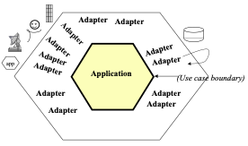

Figure 2 是两个端口、每侧多个适配器。左侧（应用控制侧）可以是回归测试、人、远程 HTTP 应用或本地另一个应用。右侧（数据获取侧）可以是 mock、测试库或运行库。功能说明对着内六边形的接口写，不对着某一种外部技术写。

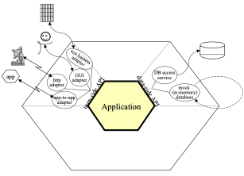

Figure 3 把同一结构映射回三层，并标出开发顺序：1. FIT 加 mock 数据库；2. 加上 GUI，仍用 mock；3. 自动化脚本对测试库做集成测试；4. 真人使用生产库。

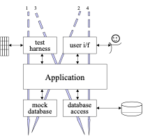

Figure 4 来自天气警报系统，四个端口按目的划分：天气数据进入、管理员、通知订阅者、订阅者数据库。后来增加的 HTTP 馈送和电子邮件通知是新适配器，不是新应用。

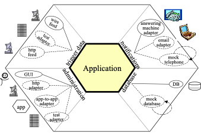

六边形内部如何再分成应用服务、领域服务和领域模型，这篇文章没有规定。它只固定内外边界和端口。应用层与领域层的区分，Evans 2003 已经给出；Palermo 2008 给出的是同心圆里的分层。

依据 Figure 2 重绘依赖方向。图上两侧端口名为 user-side API 与 data-side API。下面的次端口借用后文折扣示例里的 `RateRepository` 这个名字。适配器依赖端口，应用依赖自己定义的次端口接口，不依赖适配器：

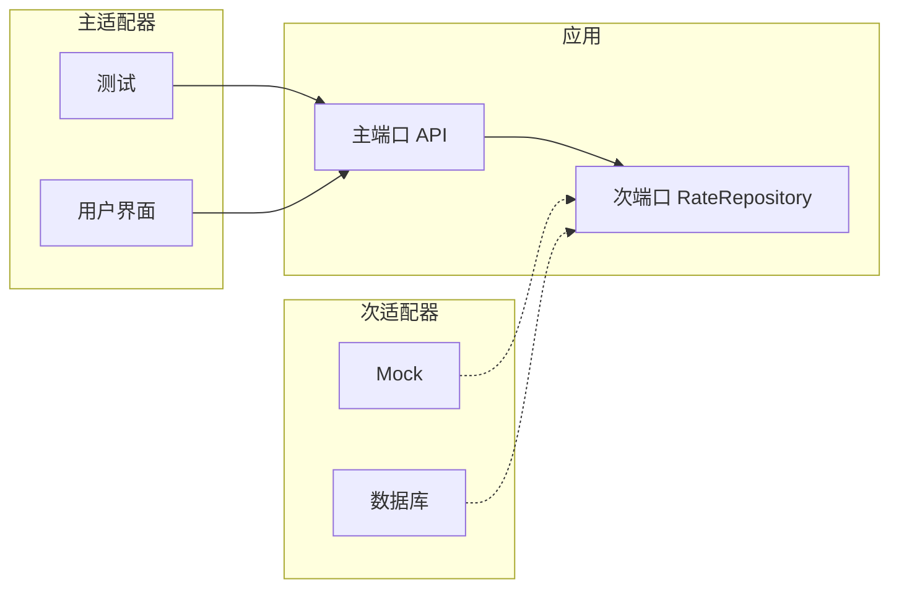

虚线表示次适配器实现次端口，依赖指向应用内部。

### 3.3 示例代码

原文 Stage 3 的依赖形状如下。文章里还有 `RepositoryFactory.getMockRateRepository()`，FIT 夹具用它装入 mock；工厂方法这里省略，依赖方向不变。括号按文章中的代码补全：

```java
public interface RateRepository {
    double getRate(double amount);
}

public final class MockRateRepository implements RateRepository {
    public double getRate(double amount) {
        if (amount <= 100) return 0.01;
        if (amount <= 1000) return 0.02;
        return 0.05;
    }
}

public final class Discounter {
    private final RateRepository rateRepository;

    public Discounter(RateRepository repository) {
        this.rateRepository = repository;
    }

    public double discount(double amount) {
        return amount * rateRepository.getRate(amount);
    }
}
```

FIT 夹具或 GUI 是主适配器，它们 `new Discounter(repository)` 并调用 `discount`。`Discounter` 是应用，不知道调用者是测试还是界面，也不知道费率来自 mock 还是 SQL。主端口在这个例子里就是 `discount` 这个方法，Cockburn 没有再为它声明一个接口。

同一形状用到下单：

```java
package hex.application;

/** 次端口。协议按应用的需要定义，不照抄某家数据库的 API。 */
public interface OrderRepository {
    void save(Order order);
}

public interface CustomerRepository {
    Customer find(String customerId);
}

public final class Customer {
    private final String id;
    private final long creditLimitCents;
    private final long outstandingCents;

    public Customer(String id, long creditLimitCents, long outstandingCents) {
        this.id = id;
        this.creditLimitCents = creditLimitCents;
        this.outstandingCents = outstandingCents;
    }

    public String id() { return id; }

    public boolean canAfford(long orderCents) {
        return outstandingCents + orderCents <= creditLimitCents;
    }
}

public final class Order {
    private final String id;
    private final String customerId;
    private final long totalCents;

    public Order(String id, String customerId, long totalCents) {
        this.id = id;
        this.customerId = customerId;
        this.totalCents = totalCents;
    }

    public String id() { return id; }
    public String customerId() { return customerId; }
    public long totalCents() { return totalCents; }
}

/** 应用。主端口是 place 方法本身。 */
public final class PlaceOrderApplication {
    private final CustomerRepository customers;
    private final OrderRepository orders;

    public PlaceOrderApplication(CustomerRepository customers, OrderRepository orders) {
        this.customers = customers;
        this.orders = orders;
    }

    public String place(String customerId, long amountCents) {
        var customer = customers.find(customerId);
        if (!customer.canAfford(amountCents)) {
            throw new IllegalStateException("信用额度不足");
        }
        var order = new Order("ord-1", customer.id(), amountCents);
        orders.save(order);
        return order.id();
    }
}
```

```java
package hex.adapter.primary;

import hex.application.PlaceOrderApplication;

/** 主适配器：把 HTTP 译成对应用 API 的调用。测试可以换成另一个主适配器。 */
public final class PlaceOrderController {
    private final PlaceOrderApplication application;

    public PlaceOrderController(PlaceOrderApplication application) {
        this.application = application;
    }

    public String post(String customerId, long amountCents) {
        return application.place(customerId, amountCents);
    }
}
```

```java
package hex.adapter.secondary;

import hex.application.Customer;
import hex.application.CustomerRepository;
import hex.application.Order;
import hex.application.OrderRepository;

public final class JdbcCustomerRepository implements CustomerRepository {
    public Customer find(String customerId) {
        return new Customer(customerId, 10_000_00L, 2_000_00L);
    }
}

public final class JdbcOrderRepository implements OrderRepository {
    public void save(Order order) { /* SQL */ }
}
```

```java
package hex.adapter.secondary;

import hex.application.Customer;
import hex.application.CustomerRepository;
import hex.application.Order;
import hex.application.OrderRepository;

/** 次端口的 mock。应用不依赖这个类，测试装配时把它注进去。 */
public final class InMemoryOrderRepository implements OrderRepository {
    public void save(Order order) { /* 记在内存 */ }
}

public final class FakeCustomerRepository implements CustomerRepository {
    public Customer find(String customerId) {
        return new Customer(customerId, 10_000_00L, 0L);
    }
}
```

`hex.application` 不 import `hex.adapter`。更换数据库或把控制器换成命令行，改的是适配器和装配处，不是 `PlaceOrderApplication`。Cockburn 的文章不规定应用内部如何再分成领域服务和应用服务。

## 4. 洋葱架构（Palermo，2008）

### 4.1 概念

Palermo 在 2008-07-29 的 *The Onion Architecture : part 1* 里把这个结构命名为洋葱架构。他自己写明：它和六边形共享一个前提，把基础设施外置，并编写适配代码，使基础设施不与应用耦死。他把应用核心分成 Domain Model、Domain Services、Application Services，并规定耦合只指向中心。核心内的层数可以变化，领域模型保持在最中心。Graça 2017 另写过一句：洋葱架构取来 DDD 的分层，放进端口与适配器，用来组织端口与适配器内部的业务逻辑。那是 Graça 的句子，不是 Palermo 自己的句子。

规则是：代码可以依赖更靠近中心的层，不能依赖比自己更靠外的层。所有耦合朝向中心。领域模型在最中心，只与自己耦合。

part 1 的圈从内到外是：

- Domain Model
- Domain Services
- Application Services
- 外圈：User Interface、Infrastructure、Tests

横跨中部的色带标为 Application Core，用来区分核心与外圈。外圈留给经常变化的东西。仓储接口留在应用核心里；part 1 说它们通常放在紧挨领域模型的那一圈。真正写数据库的类在核心之外，它实现核心里的接口，因此依赖指向中心。对象的保存行为本身不在核心里，因为那通常意味着数据库。

运行时需要依赖注入或同类机制，把外圈的实现交给核心里声明的接口。数据库不是中心。应用可以使用数据库，但只通过实现了核心接口的外部基础设施代码。

part 2（2008-07-30）用 CodeCampServer 做了一条垂直切片，原文构造器是：

```java
public SpeakerController(IConferenceRepository conferenceRepository,
                         IUserSession userSession, IClock clock)
    : base(userSession)
{
    _conferenceRepository = conferenceRepository;
    _clock = clock;
    _userSession = userSession;
}
```

`SpeakerController` 属于用户界面，依赖 ASP.NET MVC。它只依赖定义在应用核心中的接口。`ConferenceRepository` 与 `UserSession` 这两个类在核心之外，各自实现更靠近中心的接口。Palermo 写明：控制器与 `UserSession` 处于同一外层，原则上可以直接使用 `UserSession`；示例构造器仍然注入的是 `IUserSession`。控制器不能直接使用 `ConferenceRepository`，必须由外部把 `IConferenceRepository` 传进来。外圈上的界面切片和基础设施切片不互相依赖，它们都依赖核心。

本文保存的 part 2 图把内两圈标成 Object Model 与 Object Services，类名按这个示例放置。part 1 的模式图用的是 Domain Model 与 Domain Services。两张图的位置对应，命名随示例变过。

### 4.2 架构图

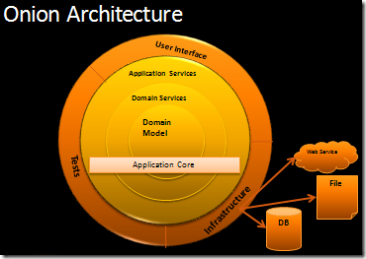

原图：Jeffrey Palermo, [The Onion Architecture : part 1](https://jeffreypalermo.com/2008/07/the-onion-architecture-part-1/)。外圈是 User Interface、Tests、Infrastructure；向内是 Application Services、Domain Services、Domain Model。右侧 DB、File、Web Service 落在基础设施之外，经基础设施进入核心。

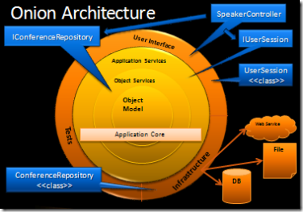

原图：Jeffrey Palermo, [The Onion Architecture : part 2](https://jeffreypalermo.com/2008/07/the-onion-architecture-part-2/)。`SpeakerController` 在用户界面，`IConferenceRepository` 在应用核心，`ConferenceRepository` 在核心外。

结构复原：

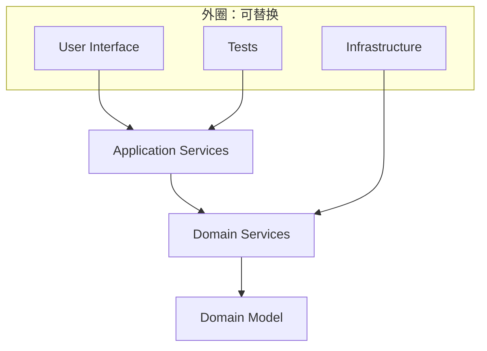

`Infrastructure → Domain Services` 表示仓储实现依赖核心中的接口。按 part 1，这些接口通常位于紧挨领域模型的 Domain Services 一圈，不是 Application Services 一圈。应用服务依赖领域，不依赖基础设施具体类。外圈也可以越过应用服务，直接依赖更靠近中心的层。

### 4.3 示例代码

领域模型没有任何向外的 import。跨实体的信用规则放在领域服务。仓储接口按 part 1 放在 Domain Services 这一圈，与领域服务同层；基础设施实现这些接口。Palermo 没有禁止领域服务使用仓储接口。下面的 `CreditPolicy` 不调用仓储，只是这个例子把取数留在应用服务；「领域服务不得知道仓储」是 Graça 2017 的规则，见第 6 节。

```java
package onion.domain.model;

public final class Customer {
    private final String id;
    private final long creditLimitCents;
    private final long outstandingCents;

    public Customer(String id, long creditLimitCents, long outstandingCents) {
        this.id = id;
        this.creditLimitCents = creditLimitCents;
        this.outstandingCents = outstandingCents;
    }

    public String id() { return id; }
    public long creditLimitCents() { return creditLimitCents; }
    public long outstandingCents() { return outstandingCents; }
}

public final class Order {
    private final String id;
    private final String customerId;
    private final long totalCents;

    private Order(String id, String customerId, long totalCents) {
        this.id = id;
        this.customerId = customerId;
        this.totalCents = totalCents;
    }

    public static Order draft(String id, String customerId, long totalCents) {
        return new Order(id, customerId, totalCents);
    }

    public String id() { return id; }
    public String customerId() { return customerId; }
    public long totalCents() { return totalCents; }
}
```

```java
package onion.domain.service;

import onion.domain.model.Customer;
import onion.domain.model.Order;

/** 本示例不调用仓储。Palermo 允许这一圈上的领域服务使用仓储接口。 */
public final class CreditPolicy {
    public void assertAffordable(Customer customer, Order order) {
        long used = customer.outstandingCents() + order.totalCents();
        if (used > customer.creditLimitCents()) {
            throw new IllegalStateException("信用额度不足");
        }
    }
}
```

```java
package onion.domain.service;

import onion.domain.model.Customer;
import onion.domain.model.Order;

/** part 1：仓储接口通常放在紧挨领域模型的这一圈。 */
public interface CustomerRepository {
    Customer find(String customerId);
}

public interface OrderRepository {
    void save(Order order);
}
```

```java
package onion.application;

import onion.domain.model.Order;
import onion.domain.service.CreditPolicy;
import onion.domain.service.CustomerRepository;
import onion.domain.service.OrderRepository;

public final class PlaceOrderService {
    private final CustomerRepository customers;
    private final OrderRepository orders;
    private final CreditPolicy credit;

    public PlaceOrderService(CustomerRepository customers, OrderRepository orders, CreditPolicy credit) {
        this.customers = customers;
        this.orders = orders;
        this.credit = credit;
    }

    public String place(String customerId, long amountCents) {
        var customer = customers.find(customerId);
        var order = Order.draft("ord-1", customer.id(), amountCents);
        credit.assertAffordable(customer, order);
        orders.save(order);
        return order.id();
    }
}
```

```java
package onion.infrastructure;

import onion.domain.model.Customer;
import onion.domain.model.Order;
import onion.domain.service.CustomerRepository;
import onion.domain.service.OrderRepository;

public final class JdbcCustomerRepository implements CustomerRepository {
    public Customer find(String customerId) {
        return new Customer(customerId, 10_000_00L, 2_000_00L);
    }
}

public final class JdbcOrderRepository implements OrderRepository {
    public void save(Order order) { /* SQL */ }
}
```

```java
package onion.ui;

import onion.application.PlaceOrderService;

public final class PlaceOrderController {
    private final PlaceOrderService service;

    public PlaceOrderController(PlaceOrderService service) {
        this.service = service;
    }

    public String post(String customerId, long amountCents) {
        return service.place(customerId, amountCents);
    }
}
```

`onion.domain.model` 没有向外的 import。`CreditPolicy` 在这个例子里只 import 领域模型。仓储接口与它同在 `onion.domain.service`，`onion.infrastructure` 实现这些接口。`onion.ui` 依赖应用服务，不 import 基础设施。这和 part 2 里控制器不能直接使用 `ConferenceRepository` 是同一条规则。

和六边形示例的差别在内核内部：信用规则拆进了领域服务，仓储接口放在 Domain Services 一圈。六边形允许把这些都放在一个 `application` 包里。本例的 `CreditPolicy` 不 import 仓储，这不是洋葱的要求。

## 5. 整洁架构（Martin，2012）

### 5.1 概念

Robert C. Martin 在 2012-08-13 的 *The Clean Architecture* 中说，六边形、洋葱、他自己前一年的 Screaming Architecture、James Coplien 与 Trygve Reenskaug 的 DCI，以及 Ivar Jacobson 的 BCE，细节不同，目标相同：分离关注点，至少分出业务规则和接口。文首那张图是把这些架构收成一个可执行想法的尝试。

他列出五项目标：不依赖框架；业务规则可以在没有界面、数据库、Web 服务器或其他外部元素时测试；界面可替换；数据库可替换；业务规则不知道外部机构。

同心圆越往内，软件层次越高。外圈是机制，内圈是策略。压倒一切的是**依赖规则**：源码依赖只能指向内圈。内圈不能提及外圈声明的任何名字，包括函数、类、变量或其他命名实体。外圈的数据格式，尤其是框架生成的格式，也不能被内圈使用。

四圈在原文中的含义是：

- **实体（Entities）**：企业级业务规则。可以是带方法的对象，也可以是一组数据结构和函数。没有「整个企业」时，它们就是这个应用的业务对象，封装最一般、最高层的规则。页面导航或安全机制这类操作变化不应影响实体。这里的 Entity 比 DDD 的实体宽，依据是 Martin 自己的句子：实体可以是带方法的对象，也可以是一组数据结构和函数。
- **用例（Use Cases）**：应用特有的业务规则，编排进出实体的数据流，并指示实体用其企业级规则完成用例目标。用例的操作细节变化会改变这一层；数据库、界面和框架的变化不应改变这一层。
- **接口适配器（Interface Adapters）**：在用例、实体最方便的数据格式与外部机构最方便的格式之间转换。GUI 的 MVC 整个属于这里：Presenter、View、Controller 都在这圈。模型多半是从控制器传到用例、再从用例传回 presenter 的数据结构。若数据库是 SQL，全部 SQL 都限制在这一圈里与数据库有关的部分。外部服务的适配器也在这里。
- **框架与驱动（Frameworks and Drivers）**：数据库、Web 框架等工具。这一层通常只写把调用传向内一圈的胶水代码。Web 是细节，数据库是细节。

圈数是示意。可以多于四圈。依赖规则不变：向内，抽象升高，最内圈最一般。

右下角的小图处理一个表面矛盾。控制流从控制器进入用例，再进入 presenter。源码依赖却必须向内。做法是依赖倒置：用例调用内圈的接口（图中的 Use Case Output Port），外圈的 presenter 实现该接口。用例需要 presenter 时不能直接点名外圈的类。所有边界都用动态多态，让源码依赖在跨越边界时与控制流相反。

跨边界的数据是简单数据结构：基本结构体、简单 DTO、函数参数、哈希表或普通对象。不把实体或数据库行传过边界。内圈不认识外圈的 `RowStructure`。数据形式以对内圈方便为准。

Screaming Architecture（2011）是他列出的来源之一：系统的顶层结构应先呈现出用例，而不是先呈现出框架名称。

### 5.2 架构图


原图：Robert C. Martin, [The Clean Architecture](https://blog.cleancoder.com/uncle-bob/2012/08/13/the-clean-architecture.html)，2012-08-13。

图例四色从内到外：

| 颜色 | 圈 | 图上的标签 |
| --- | --- | --- |
| 黄 | 企业级业务规则 | Entities |
| 粉 | 应用级业务规则 | Use Cases |
| 绿 | 接口适配器 | Controllers、Gateways、Presenters |
| 蓝 | 框架与驱动 | Devices、Web、UI、DB、External Interfaces |

右侧小图：Controller 使用 Input Port；Interactor 实现 Input Port，并使用 Output Port；Presenter 实现 Output Port。Interactor 指向 Input Port、Presenter 指向 Output Port 的是空心三角，表示实现。图上没有 Controller 到 Interactor 的依赖边。粉色曲线是控制流，从控制器经交互器到 presenter。

结构复原只保留依赖规则，不复制原图的配色。2012 年正文写明 SQL 留在接口适配器圈，没有写明网关接口属于哪一圈。原图把 “Gateways” 写在绿圈，把 “DB” 写在蓝圈。下面把网关接口画在用例圈，只是为了让交互器不点名外圈的类，从而遵守这篇 2012 年文章的依赖规则。本文对整洁架构的陈述以这篇文章和文首原图为准，不另用 2017 年成书里的图。

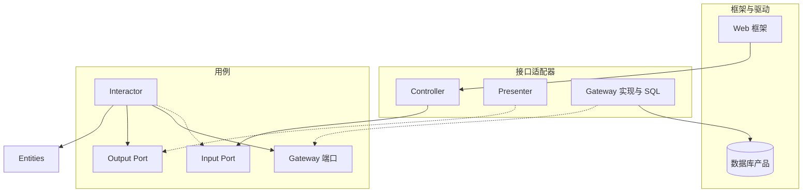

实线是源码依赖。`interactor -.-> inPort` 与 `presenter -.-> outPort`、`gateway -.-> gwPort` 表示外圈或交互器实现内圈端口。数据库产品被适配器使用，适配器不把数据库的行类型传入用例。

### 5.3 示例代码

实体不知道用例。用例通过自己定义的输出端口和网关端口说话。控制器只看见输入端口。通向 presenter 的响应是 DTO，不是 `Order`。网关方法仍返回实体，因为用例要调用 `canAfford`；这比 2012 年「跨边界不传实体」更松。更严的读法是网关只交简单结构，由交互器在用例圈内重建实体。额度不足在本例里抛出异常，没有走输出端口；若失败也要呈现，应在 `PlaceOrderOutput` 上增加对应方法。

```java
package clean.entity;

public final class Customer {
    private final String id;
    private final long creditLimitCents;
    private final long outstandingCents;

    public Customer(String id, long creditLimitCents, long outstandingCents) {
        this.id = id;
        this.creditLimitCents = creditLimitCents;
        this.outstandingCents = outstandingCents;
    }

    public String id() { return id; }

    public boolean canAfford(long orderCents) {
        return outstandingCents + orderCents <= creditLimitCents;
    }
}

public final class Order {
    private final String id;
    private final String customerId;
    private final long totalCents;

    public Order(String id, String customerId, long totalCents) {
        this.id = id;
        this.customerId = customerId;
        this.totalCents = totalCents;
    }

    public String id() { return id; }
    public String customerId() { return customerId; }
    public long totalCents() { return totalCents; }
}
```

```java
package clean.usecase;

import clean.entity.Customer;
import clean.entity.Order;

public record PlaceOrderRequest(String customerId, long amountCents) {}

public record PlaceOrderResponse(String orderId, long totalCents) {}

public interface PlaceOrderInput {
    void place(PlaceOrderRequest request);
}

/** 输出端口在用例圈。Presenter 在外圈实现它。 */
public interface PlaceOrderOutput {
    void present(PlaceOrderResponse response);
}

/** 网关端口在用例圈。SQL 不得出现在这个包。 */
public interface CustomerGateway {
    Customer find(String customerId);
}

public interface OrderGateway {
    void save(Order order);
}

public final class PlaceOrderInteractor implements PlaceOrderInput {
    private final CustomerGateway customers;
    private final OrderGateway orders;
    private final PlaceOrderOutput output;

    public PlaceOrderInteractor(CustomerGateway customers, OrderGateway orders, PlaceOrderOutput output) {
        this.customers = customers;
        this.orders = orders;
        this.output = output;
    }

    public void place(PlaceOrderRequest request) {
        var customer = customers.find(request.customerId());
        if (!customer.canAfford(request.amountCents())) {
            throw new IllegalStateException("信用额度不足");
        }
        var order = new Order("ord-1", customer.id(), request.amountCents());
        orders.save(order);
        output.present(new PlaceOrderResponse(order.id(), order.totalCents()));
    }
}
```

```java
package clean.adapter.ui;

import clean.usecase.PlaceOrderInput;
import clean.usecase.PlaceOrderOutput;
import clean.usecase.PlaceOrderRequest;
import clean.usecase.PlaceOrderResponse;

public final class PlaceOrderController {
    private final PlaceOrderInput input;

    public PlaceOrderController(PlaceOrderInput input) {
        this.input = input;
    }

    public void post(String customerId, long amountCents) {
        input.place(new PlaceOrderRequest(customerId, amountCents));
    }
}

public final class PlaceOrderPresenter implements PlaceOrderOutput {
    public void present(PlaceOrderResponse response) {
        System.out.println(response.orderId() + ":" + response.totalCents());
    }
}
```

```java
package clean.adapter.gateway;

import clean.entity.Customer;
import clean.entity.Order;
import clean.usecase.CustomerGateway;
import clean.usecase.OrderGateway;

public final class JdbcCustomerGateway implements CustomerGateway {
    public Customer find(String customerId) {
        return new Customer(customerId, 10_000_00L, 2_000_00L);
    }
}

public final class JdbcOrderGateway implements OrderGateway {
    public void save(Order order) { /* SQL */ }
}
```

装配放在最外层。这个 `main` 就是 Martin 所说的、允许知道所有具体类的胶水：

```java
public final class Main {
    public static void main(String[] args) {
        var presenter = new clean.adapter.ui.PlaceOrderPresenter();
        var interactor = new clean.usecase.PlaceOrderInteractor(
                new clean.adapter.gateway.JdbcCustomerGateway(),
                new clean.adapter.gateway.JdbcOrderGateway(),
                presenter);
        var controller = new clean.adapter.ui.PlaceOrderController(interactor);
        controller.post("cust-1", 3_000_00L);
    }
}
```

控制流是 Controller → Interactor → Presenter。源码上 Controller 只依赖 `PlaceOrderInput`，Presenter 只依赖 `PlaceOrderOutput`，两个网关实现只依赖用例圈里的接口。`PlaceOrderInteractor` 的 import 没有适配器包。

和洋葱示例相比，这里多了三件被写死的事：输入端口与输出端口分开、跨边界使用 `PlaceOrderRequest` / `PlaceOrderResponse`、实体类型不进入 presenter。信用规则仍在实体 `Customer` 上。若规则要跨多个实体，按 Martin 对实体的宽定义，可以放在最内圈的一个函数或对象里；他没有强制单独的领域服务圈。

## 6. 清晰架构（Graça，2017）

### 6.1 概念

Herberto Graça 在 2017-11-16 的文章 *DDD, Hexagonal, Onion, Clean, CQRS, … How I put it all together* 里把这张合成图命名为 Explicit Architecture。文章属于他的系列 The Software Architecture Chronicles。他声明这些构造已经用在两个生产系统里：一个全球有数千网店的 SaaS 电商平台，一个在两个国家运行、消息总线每月处理超过两千万条消息的市场。

它不是新的同心圆，而是把已有部分放进同一张可检查的图：

- 来自 EBI 与端口适配器的三分：用户界面如何跑起来、应用核心、连接数据库和第三方的基础设施。
- 来自六边形的端口、主适配器、次适配器，以及「端口按核心的需要设计，不照抄工具 API」。
- 来自洋葱的内核分层，依赖指向中心。
- 来自整洁架构的用例和依赖规则。
- 命令总线与查询总线。2017 年这篇文章使用它们，文中没有写出另一位作者。
- 领域事件与应用事件。
- 来自 Martin 的 Screaming Architecture 和 Simon Brown 的 package by component：粗粒度按子域和限界上下文分包，而不是只按技术层分包。

三个基本块是：使某种用户界面得以运行的代码；真正完成工作的应用核心；把核心连到数据库、搜索引擎、第三方 API 的基础设施。典型控制流是：用户界面 → 应用核心 → 基础设施 → 回到应用核心 → 回到用户界面。

工具远离核心。CLI 和 Web 服务器用来告诉应用去做某事；数据库引擎被应用要求去做某事。这个差别决定适配器的两种接法。

- **端口**在业务逻辑内部。最简单的形式是接口，也可以是一组接口加 DTO。它规定工具如何使用核心，或核心如何使用工具。
- **主适配器（Primary / Driving）**包住端口并调用它，把交付机制译成核心上的方法调用。控制器或控制台命令的构造器接收端口的实现。端口可以是服务接口、仓储接口，也可以是命令总线或查询总线。
- **次适配器（Secondary / Driven）**实现端口，再被注入到核心里声明了该端口的地方。换 PostgreSQL 或 MongoDB 时，新写一个实现同一端口的适配器并换注入。

适配器依赖具体工具，也依赖端口。业务逻辑只依赖按自己需要设计的端口。跨过核心边界的依赖指向内部。

内核再分层：

- **应用层**：用例所在。一等公民是应用服务及其接口；端口也在这一层，包括仓储、搜索、消息等接口。使用命令总线或查询总线时，处理器也在这一层。应用服务的典型步骤是：用仓储取出实体，让实体执行领域逻辑，再用仓储保存。命令处理器可以自己含有用例逻辑，也可以只转调已有的应用服务。Graça 写明，多数情况下处理器直接含有用例；只有另一处要复用时才抽成应用服务。应用服务的接口可以有，但不是为了替换实现，因为他不打算把应用服务换成另一个实现。这一层还负责发布**应用事件**，表示用例的结果，用来触发邮件、第三方通知、推送，或另一个组件里的用例。
- **领域层**：数据和操作这些数据的逻辑，与触发它们的业务流程无关，完全不知道应用层。
- **领域服务**：接收一组实体并执行业务逻辑。它属于领域层，因此不知道应用服务，也不知道仓储。它可以使用其他领域服务和领域模型。Graça 的理由是：若把这种逻辑放进应用服务，其他用例就无法当领域规则复用。
- **领域模型**：正中心，不依赖外面任何东西。实体、值对象、枚举，以及**领域事件**。领域事件在某组数据变化时触发，并携带变化后的值，适合事件溯源。

Graça 把仓储端口放在应用层，并写明领域服务不知道仓储。示例代码按他的放法。

组件是横切这些层的粗粒度单位，例如 Billing、User、Review、Account，并且与领域相关。认证、授权这类限界上下文，他建议看成外部工具：为它写适配器，藏在端口后面。

组件之间的解耦不能只靠类级别的依赖注入。一个组件不能引用另一个组件里的类，包括接口。要在组件 A 发生某事时让组件 B 动作，A 发布应用事件，B 的监听器接收。若事件类型定义在 A，B 就知道 A。于是他把事件等最小公共物放进 **Shared Kernel**：各组件依赖共享内核，彼此不依赖。共享内核要小，因为它一变，所有组件都受影响。多语言的微服务里，共享内核还应与语言无关，例如用 JSON 描述事件，而不是放一个 Java 类。

这里的 Shared Kernel 和 Evans 战略设计里的 Shared Kernel 同名。Graça 在 2018 年的 *More than concentric layers* 里引用了 Evans 的定义：两个团队同意共享的一部分领域模型，以及与之相关的代码或数据库设计，未经对方同意不能修改。他自己的用法更窄。2017 年的文章里，共享内核主要放应用事件、领域事件，也可以放规格对象。2018 年他把内容收成事件以及事件要用的标识、值对象和枚举，并建议不要把实体放进事件。多语言系统里，这份共享描述还应与语言无关。

组件可以查询不属于自己的数据，但不能修改。共享存储时，用只读查询读取别人的数据。各自拥有存储时，持有本地副本；拥有者发出领域事件，副本持有者据此更新。需要同步调用时，他给出的办法是发现服务或由发现服务代理，使组件依赖发现服务而不是互相点名。

不使用命令总线时，控制器依赖应用服务或查询对象。查询对象返回 DTO，再放进 ViewModel；它优化的是读取，不执行改变状态的用例。使用命令总线时，控制器依赖总线以及命令或查询对象，总线按配置找到处理器。总线、命令、查询、处理器彼此不在类型上点名，对应关系由配置建立。两种画法里，穿过应用核心边界的箭头都指向内部。

他的收束句是图上的一行小字：理解全部这些，但只使用你需要的部分。

### 6.2 架构图

原图是一组逐步叠加上去的 PNG，页面发表于 2017-11-16，这些 PNG 的上传路径在 2018-11，属于文章后来的修订（页面另有 2020-03-20 的更新记录）。文件名带 svg，发布文件是 PNG。下面按叠图顺序选四张。同目录还有 `010`–`030`、`060`、`080`：`060` 开始画出应用层。文章里还有一张 `100` 总览，本文没有另存。

先只有应用核心。左侧区域是用户界面，右侧是基础设施：

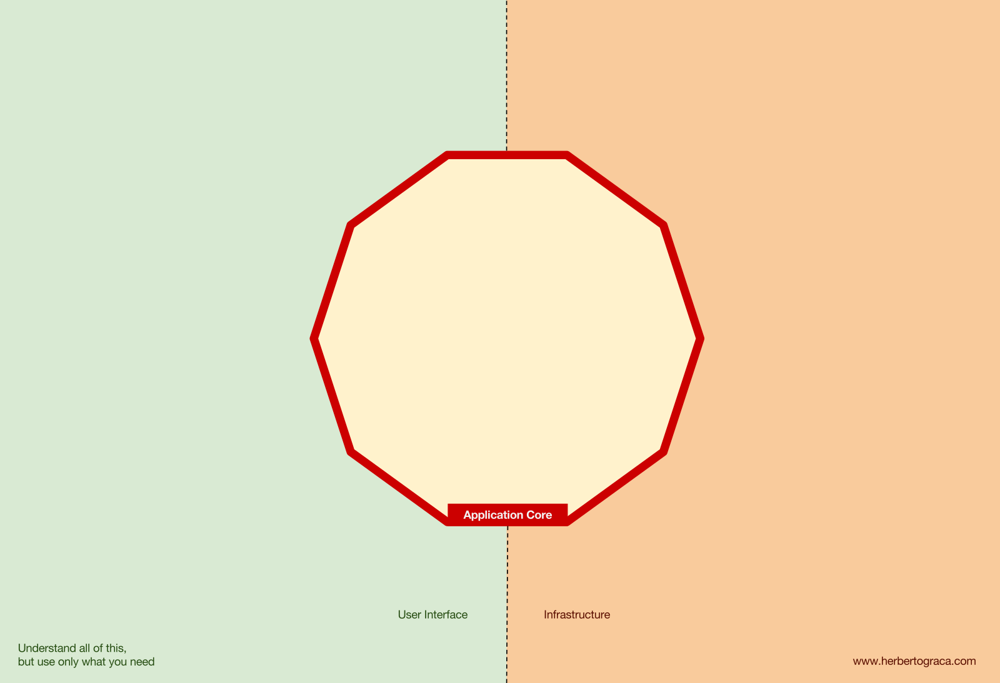

加上主适配器、次适配器和工具，核心内部仍是空的：

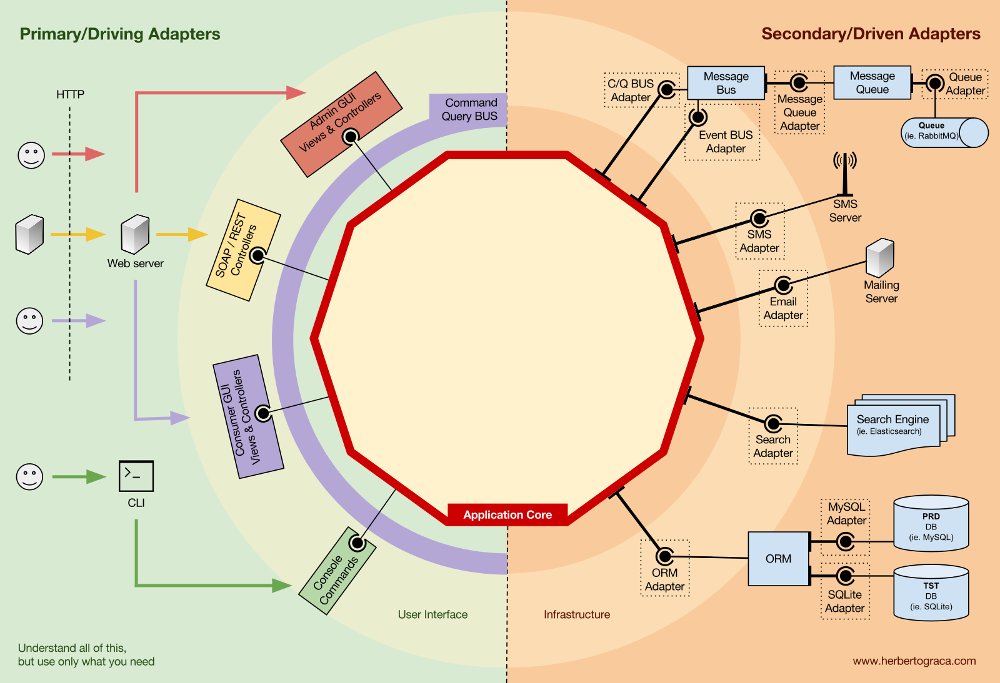

端口写在核心边界上。依赖指向内部。命令、查询、服务从左侧进入；持久化、搜索、通知、事件总线从右侧出去：

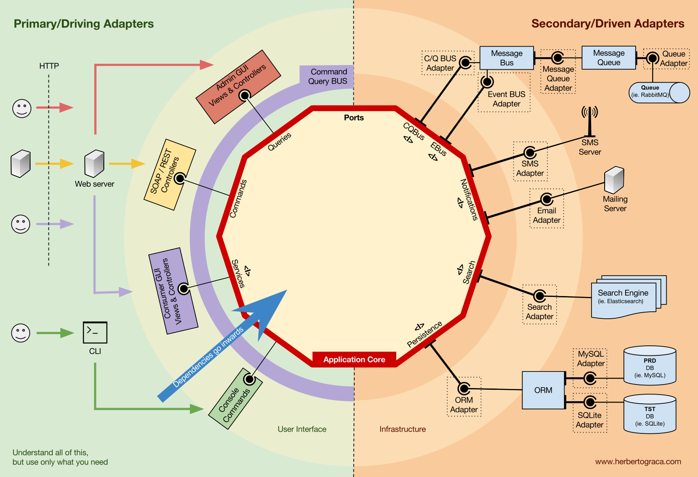

内核按洋葱展开。端口内侧是应用层，其中有应用服务和命令/查询处理器。再向内是领域层。领域层包住外侧的领域服务和正中心的领域模型。图上红色的 Domain Layer 不是夹在领域服务和领域模型之间的另一圈：

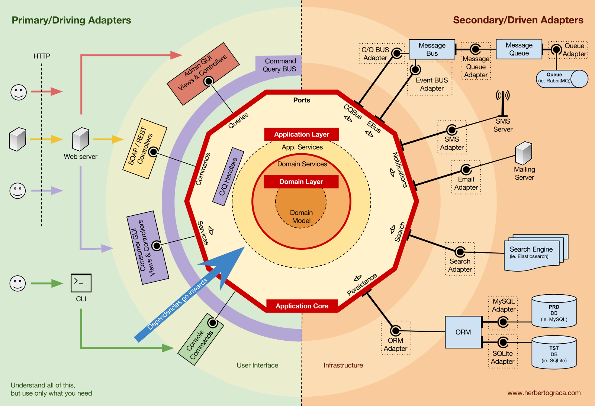

文中还嵌有一张分层总图，文件上传于 2018-07，出自后续文章 *More than concentric layers*，不是 2017-11-16 初稿里的图。最上一层是应用核心、界面和适配器，其下是 Shared Kernel，再向下是语言扩展和语言本身。右侧箭头写明 Dependencies go downwards：

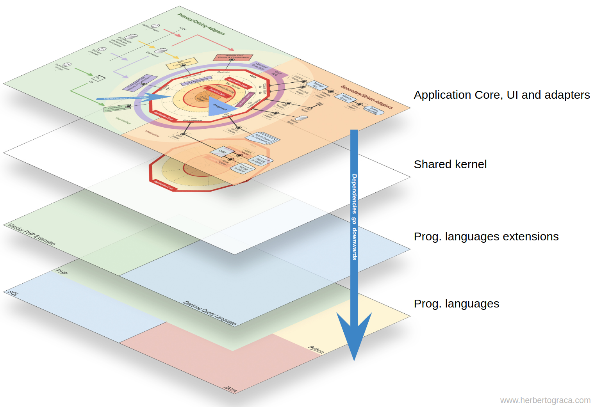

原图：Herberto Graça, [*More than concentric layers*](https://herbertograca.com/2018/07/07/more-than-concentric-layers/)，2018-07-07。左下角 “Understand all of this, but use only what you need” 印在同系列的平面叠图上，不是这张分层总图的标题。

`070` 的内圈可以重绘为：

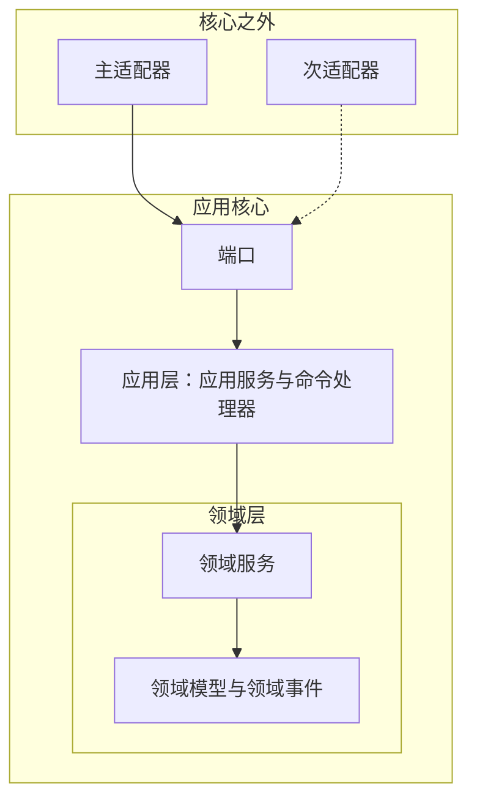

### 6.3 示例代码

仓储端口在应用层。`CreditPolicy` 只接收领域对象。控制器把命令交给总线。查询返回 DTO，不返回实体。订单组件与账单组件只共享内核里的应用事件。

```java
package explicit.sharedkernel;

/** 放在共享内核，避免 billing 引用 order 组件的类。 */
public interface ApplicationEvent {
}

public record OrderPlaced(String orderId, String customerId, long totalCents) implements ApplicationEvent {}
```

```java
package explicit.order.domain;

public final class Customer {
    private final String id;
    private final long creditLimitCents;
    private final long outstandingCents;

    public Customer(String id, long creditLimitCents, long outstandingCents) {
        this.id = id;
        this.creditLimitCents = creditLimitCents;
        this.outstandingCents = outstandingCents;
    }

    public String id() { return id; }
    public long creditLimitCents() { return creditLimitCents; }
    public long outstandingCents() { return outstandingCents; }
}

public final class Order {
    private final String id;
    private final String customerId;
    private final long totalCents;

    public Order(String id, String customerId, long totalCents) {
        this.id = id;
        this.customerId = customerId;
        this.totalCents = totalCents;
    }

    public String id() { return id; }
    public String customerId() { return customerId; }
    public long totalCents() { return totalCents; }
}

/** 不知道应用服务，也不知道仓储。 */
public final class CreditPolicy {
    public void assertAffordable(Customer customer, Order order) {
        if (customer.outstandingCents() + order.totalCents() > customer.creditLimitCents()) {
            throw new IllegalStateException("信用额度不足");
        }
    }
}
```

```java
package explicit.order.application;

import explicit.order.domain.Customer;
import explicit.order.domain.Order;
import explicit.sharedkernel.ApplicationEvent;
import explicit.sharedkernel.OrderPlaced;

public interface Command {
}

public record PlaceOrderCommand(String customerId, long amountCents) implements Command {}

public interface CommandBus {
    void dispatch(Command command);
}

public interface CustomerRepository {
    Customer find(String customerId);
}

public interface OrderRepository {
    void save(Order order);
}

public interface ApplicationEventDispatcher {
    void dispatch(ApplicationEvent event);
}

public final class PlaceOrderHandler {
    private final CustomerRepository customers;
    private final OrderRepository orders;
    private final explicit.order.domain.CreditPolicy credit;
    private final ApplicationEventDispatcher events;

    public PlaceOrderHandler(CustomerRepository customers, OrderRepository orders,
                              explicit.order.domain.CreditPolicy credit,
                              ApplicationEventDispatcher events) {
        this.customers = customers;
        this.orders = orders;
        this.credit = credit;
        this.events = events;
    }

    public void handle(PlaceOrderCommand command) {
        var customer = customers.find(command.customerId());
        var order = new Order("ord-1", customer.id(), command.amountCents());
        credit.assertAffordable(customer, order);
        orders.save(order);
        events.dispatch(new OrderPlaced(order.id(), order.customerId(), order.totalCents()));
    }
}

/** 查询侧返回原始读模型，不返回领域实体。 */
public record OrderView(String orderId, long totalCents) {}

public final class OrderQuery {
    public OrderView find(String orderId) {
        return new OrderView(orderId, 3_000_00L);
    }
}
```

```java
package explicit.order.ui;

import explicit.order.application.CommandBus;
import explicit.order.application.PlaceOrderCommand;

public final class PlaceOrderController {
    private final CommandBus bus;

    public PlaceOrderController(CommandBus bus) {
        this.bus = bus;
    }

    public void post(String customerId, long amountCents) {
        bus.dispatch(new PlaceOrderCommand(customerId, amountCents));
    }
}
```

```java
package explicit.order.infrastructure;

import explicit.order.application.CustomerRepository;
import explicit.order.application.OrderRepository;
import explicit.order.domain.Customer;
import explicit.order.domain.Order;

public final class MySqlCustomerRepository implements CustomerRepository {
    public Customer find(String customerId) {
        return new Customer(customerId, 10_000_00L, 2_000_00L);
    }
}

public final class MySqlOrderRepository implements OrderRepository {
    public void save(Order order) { /* SQL */ }
}
```

```java
package explicit.billing.application;

import explicit.sharedkernel.OrderPlaced;

/** 账单组件只认识共享内核里的事件，不 import explicit.order。 */
public final class RecordReceivableOnOrderPlaced {
    public void on(OrderPlaced event) {
        // 按 event.totalCents() 记应收
    }
}
```

包结构对应「层是细粒度，组件是粗粒度」：

```text
explicit.sharedkernel          组件共用的应用事件
explicit.order.domain          领域模型与领域服务
explicit.order.application     用例、命令、仓储端口、查询
explicit.order.infrastructure  次适配器
explicit.order.ui              主适配器
explicit.billing.application   另一个组件的监听器
```

`CreditPolicy` 的源文件不 import `application`。`PlaceOrderController` 不 import MySQL 适配器。`RecordReceivableOnOrderPlaced` 不 import `explicit.order`。总线如何找到 `PlaceOrderHandler` 由装配配置决定，处理器类不出现在控制器的类型签名里。

若还没有命令总线，按 Graça 的第一种控制流，控制器直接依赖 `PlaceOrderHandler` 或一个应用服务。总线是可选项。图上的短信、搜索、邮件适配器，在这个下单例子里没有对应端口，就不必做。

## 7. 对照

### 7.1 同一职责落在哪里

| 职责 | 分层 2003 | 六边形 2005 | 洋葱 2008 | 整洁 2012 | 清晰 2017 |
| --- | --- | --- | --- | --- | --- |
| 业务对象 | 领域层 | 应用内部，文章未再分 | Domain Model | Entities，定义比 DDD 实体宽 | Domain Model |
| 跨实体规则 | 领域层中的领域服务 | 未规定 | Domain Services；仓储接口通常也在这一圈，领域服务可以使用它们 | 企业级规则在 Entities；用例特有规则在 Use Cases | Domain Services，且不知道仓储 |
| 用例编排 | 应用层 | 应用的公开 API | Application Services | Use Case Interactor | 应用服务或命令处理器 |
| 入口 | 用户界面层 | 主适配器 | 外圈 User Interface | Controller，在接口适配器圈 | 主适配器，可经命令总线 |
| 持久化实现 | 基础设施层，被上层调用 | 次适配器 | 外圈，实现核心中的接口 | 接口适配器中的 Gateway，SQL 在这圈 | 次适配器 |
| 持久化端口 | 第 4 章的分层表没有画依赖倒置；第 6 章把仓储写成提供领域对象的机制 | 应用拥有的次端口 | 紧挨领域模型的 Domain Services 一圈 | 2012 年正文未写明接口所在圈；本文示例为遵守依赖规则，把网关接口放在用例圈 | 应用层中的端口 |
| 跨边界数据 | 未单独立规 | 端口的 API | 未单独立规 | 简单数据结构；本文示例只在控制器/Presenter 边界使用 DTO，网关仍传递实体 | 命令、查询、DTO；查询不返回实体 |
| 源码依赖 | 向下，上层依赖下层 | 指向应用内部 | 指向更靠近中心的层 | 只能向内 | 指向核心；组件另靠事件和共享内核 |
| 多个业务模块 | 不在这张应用图里 | 不规定 | 不规定 | Screaming Architecture 要求顶层先呈现用例 | 按组件 / 限界上下文分包 |

### 7.2 示例里依赖方向的差别

五段代码完成的判断相同：`outstanding + amount <= creditLimit`。差别只在谁可以 import 谁。

- 2003 分层：`PlaceOrderService` import `JdbcOrderStore`。
- 六边形、洋葱、整洁、清晰：用例代码 import 的是自己一侧的接口，JDBC 类 import 该接口。
- 清晰：`CreditPolicy` 不 import 仓储。洋葱示例里的 `CreditPolicy` 同样没有 import 仓储，但仓储接口和它同包，Palermo 允许领域服务使用这些接口。
- 整洁：`PlaceOrderPresenter` 只看见 `PlaceOrderResponse`。网关实现类可以看见 `Order`，presenter 所在文件不 import 它。
- 清晰：`PlaceOrderController` 依赖 `CommandBus`；`billing` 只依赖 `sharedkernel.OrderPlaced`。

### 7.3 读现成讲义时容易对错的地方

Evans 的四层不是 Palermo 那张 UI / Business Logic / Data 加侧面 Infrastructure 的图。后者是 Palermo 用来批评的传统分层，见他 2008-07-29 的 part 1。

整洁架构最内圈的 Entity 不是 DDD 实体的同义词。Martin 2012 允许它是带方法的对象，或一组数据结构和函数。企业级业务规则在这一圈，应用特有的业务规则在用例圈。

清晰架构的仓储接口在应用层，领域服务不知道仓储。这是 Graça 2017 的句子。洋葱把仓储接口放在紧挨领域模型的那一圈；Palermo 2008 没有写「领域服务不得使用仓储接口」。

Cockburn 2005 写过六不是重要数字。Martin 2012 写过圈数可以多于四圈。Palermo 2008 写过核心内的层数可变，领域模型保持在中心。Graça 2017 图上的句子是理解全部构造，但只使用需要的部分。后一句说的是采纳范围。

## 8. 参考材料

### 原著与原始文章

1. Ivar Jacobson 等. *Object-Oriented Software Engineering: A Use Case Driven Approach*. Addison-Wesley, 1992. Martin 2012 把 BCE 列为来源并给出这个书名。本文不转述该书的术语。
2. Eric Evans. *Domain-Driven Design: Tackling Complexity in the Heart of Software*. Addison-Wesley, 2003. 第 4 章 Isolating the Domain。成书目录：Layered Architecture 约第 68 页，Relating the Layers 约第 72 页，The Domain Layer Is Where the Model Lives 约第 75 页，Smart UI 反模式约第 76 页。第 6 章 Repositories。Shared Kernel 在战略设计部分。层职责与 Figure 4.2 的对象名核对过 Evans 2003-04-15 手稿。书中插图不转载。
3. Alistair Cockburn. *The Hexagonal (Ports & Adapters) Architecture*. HaT Technical Report 2005.02, 2005-09-04, v0.9. <https://alistair.cockburn.us/hexagonal-architecture/>. Figure 1–4 的本地副本见 `figures/cockburn-hex-fig1.png` 至 `cockburn-hex-fig4.png`。
4. Jeffrey Palermo. *The Onion Architecture : part 1*. 2008-07-29. <https://jeffreypalermo.com/2008/07/the-onion-architecture-part-1/>. 本地副本：`figures/palermo-traditional-layers.png`、`figures/palermo-onion-part1.png`。
5. Jeffrey Palermo. *The Onion Architecture : part 2*. 2008-07-30. <https://jeffreypalermo.com/2008/07/the-onion-architecture-part-2/>. 本地副本：`figures/palermo-onion-part2.png`。
6. Robert C. Martin. *The Clean Architecture*. 2012-08-13. <https://blog.cleancoder.com/uncle-bob/2012/08/13/the-clean-architecture.html>. 本地副本：`figures/martin-clean-architecture.jpg`。本文对整洁架构的陈述以这篇文章和文首原图为准。
7. Robert C. Martin. *Screaming Architecture*. 2011-09-30. <https://blog.cleancoder.com/uncle-bob/2011/09/30/Screaming-Architecture.html>. Martin 2012 把这篇列为来源之一。
8. Robert C. Martin. *Clean Architecture: A Craftsman's Guide to Software Structure and Design*. Prentice Hall, 2017. 同一作者后来的书。本文的技术陈述不依据此书。
9. Herberto Graça. *DDD, Hexagonal, Onion, Clean, CQRS, … How I put it all together*. 2017-11-16. <https://herbertograca.com/2017/11/16/explicit-architecture-01-ddd-hexagonal-onion-clean-cqrs-how-i-put-it-all-together/>. 清晰架构的定义文本。本地副本：`figures/graca-explicit-000.png` 至 `080`。这些 PNG 的站点路径在 2018-11，属于该文后来的修订。
10. Herberto Graça. *More than concentric layers*. 2018-07-07. <https://herbertograca.com/2018/07/07/more-than-concentric-layers/>. 同一作者对共享内核和分层总图的说明。本地副本：`figures/graca-explicit-layers.png`。文中对 Evans Shared Kernel 的引文以此页为准。
11. Robert C. Martin. *Agile Software Development: Principles, Patterns, and Practices*. Prentice Hall, 2003. 第 11 章 Dependency-Inversion Principle。Cockburn 2005 的参考文献指向这一章。
12. Martin Fowler. *Inversion of Control Containers and the Dependency Injection pattern*. 2004-01-23. <https://martinfowler.com/articles/injection.html>. Cockburn 2005 的参考文献。
13. Erich Gamma, Richard Helm, Ralph Johnson, John Vlissides. *Design Patterns*. Addison-Wesley, 1995. Adapter 模式。Cockburn 2005 写明端口与适配器是该模式的一种用法，并给出页码 139–150。
14. Simon Brown. *Package by Component and Architecturally-Aligned Testing*. Graça 2017 原文所引，用来说明按组件分包。不是本文对另外四种架构的出处。<https://www.codingthearchitecture.com/2015/03/08/package_by_component_and_architecturally_aligned_testing.html>.

Graça 2017 使用 Command Bus 与 Query Bus。该文没有把这一用法宣称为自己的发明，也没有在文中给出另一篇出处。本文不另引综述来补发明者。

Graça 另有系列前篇，复述 EBI、DDD、端口与适配器、洋葱和整洁架构。那些是他的阅读笔记，不是 Evans、Cockburn、Palermo、Martin 的原文，本文讲述前四种架构时不引用它们。

### 本文图件

| 文件 | 来源 |
| --- | --- |
| `figures/cockburn-hex-fig1.png` … `fig4.png` | Cockburn 2005，文章页内 Figure 1–4 |
| `figures/palermo-traditional-layers.png` | Palermo 2008-07-29，传统分层对照图 |
| `figures/palermo-onion-part1.png` | Palermo 2008-07-29，洋葱模式图 |
| `figures/palermo-onion-part2.png` | Palermo 2008-07-30，CodeCampServer 切片 |
| `figures/martin-clean-architecture.jpg` | Martin 2012-08-13 |
| `figures/graca-explicit-000.png` 至 `080` | Graça 2017-11-16 一文的后续修订图，文件路径为 2018-11 |
| `figures/graca-explicit-layers.png` | Graça, *More than concentric layers*，2018-07 |

第 2.2 节的表按 Evans 2003 第 4 章原书版式排列：左列层名，右列职责，自上而下四行。它不是书中原图的扫描件。其余 mermaid 是对作者原图依赖方向的结构复原，便于在不显示图片时阅读。
